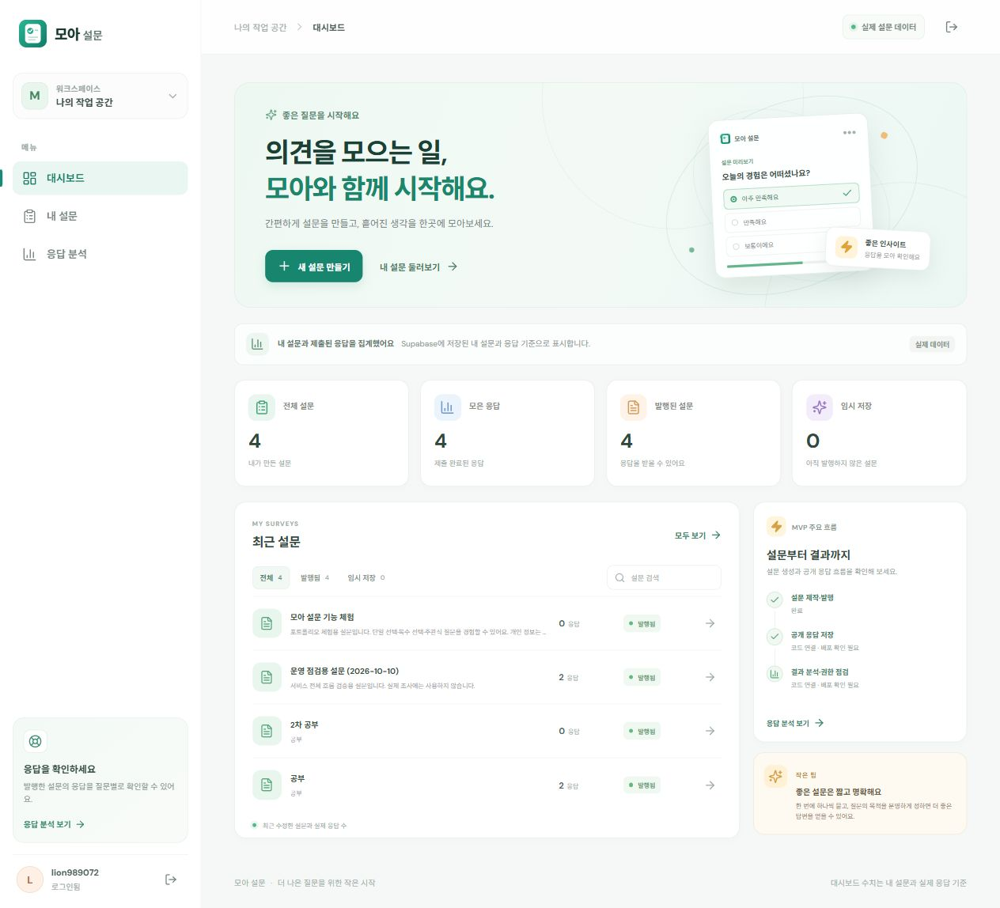
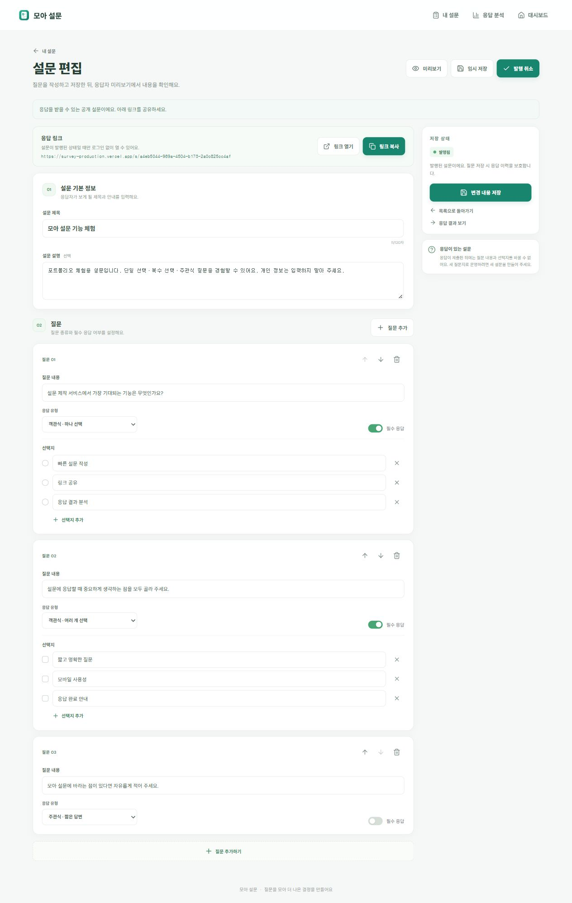
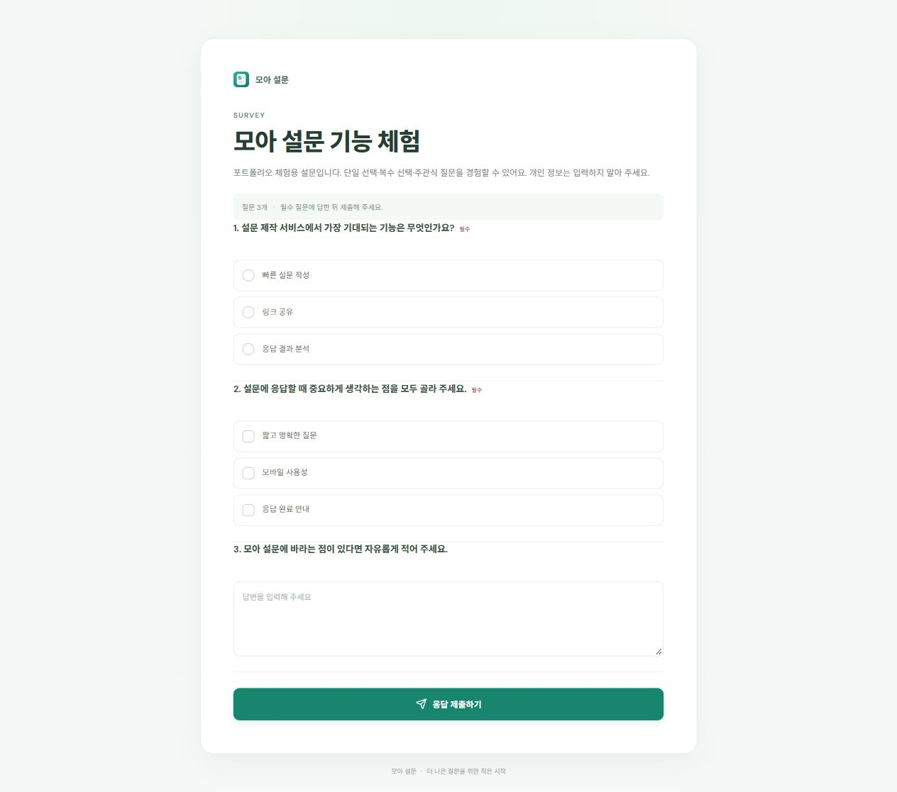
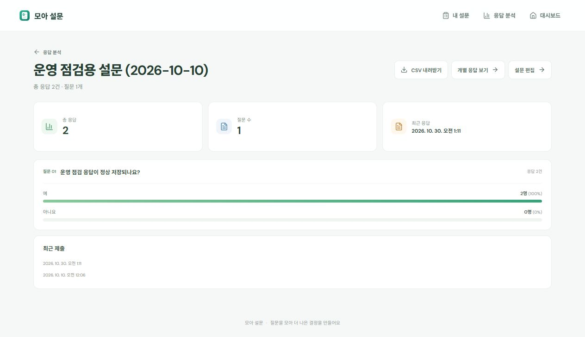
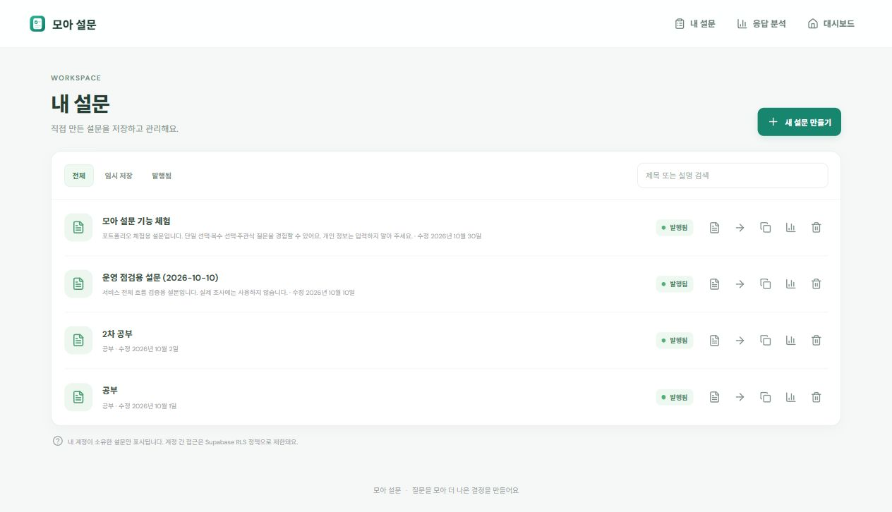
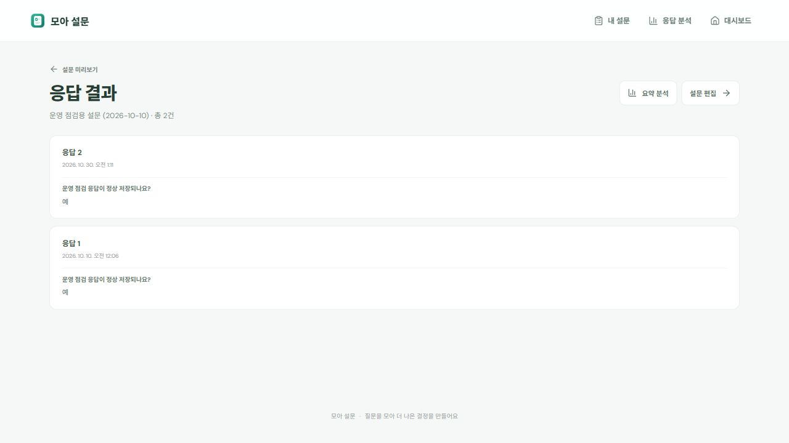
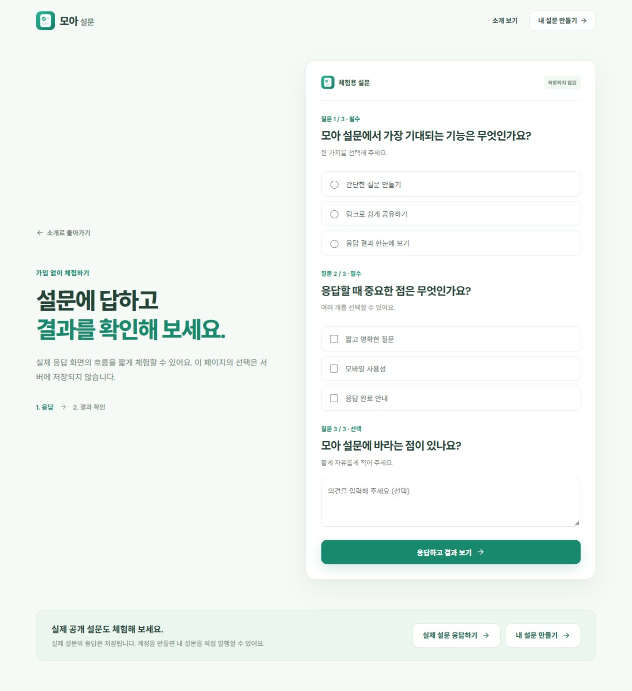
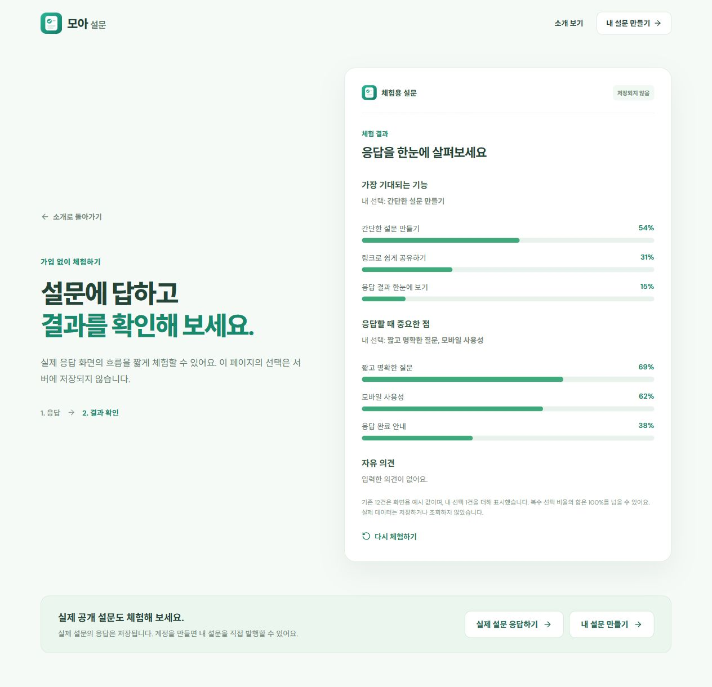
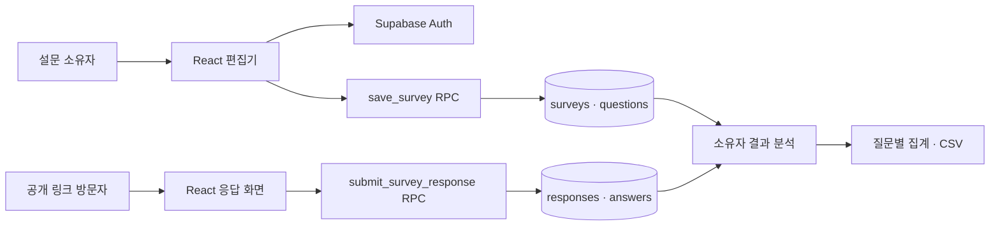

# 모아 설문 (Moa Survey)

질문 작성부터 링크 공유, 응답 수집, 결과 분석까지 한곳에서 진행하는 반응형 설문 서비스입니다. React로 화면을 만들고 Supabase에서 인증·데이터·접근 권한을 관리하며, GitHub `main` 푸시로 Vercel에 배포합니다.

| 프로젝트 | 바로가기 |
| --- | --- |
| 운영 서비스 | [모아 설문](https://survey-production.vercel.app/) |
| 비회원 기능 체험 | [저장되지 않는 예시 설문](https://survey-production.vercel.app/demo) |
| 실제 공개 응답 | [모아 설문 기능 체험](https://survey-production.vercel.app/s/a4eb5044-969a-4504-b173-2a0c825cc4af) |

## 프로젝트 소개

설문을 만드는 사람에게는 질문 편집·발행·응답 확인이 이어지는 작업 공간이 필요하고, 응답자에게는 계정 없이 열리는 간단한 입력 화면이 필요합니다. 모아 설문은 이 두 흐름을 하나의 서비스로 구현한 개인 프로젝트입니다.

- **대상:** 설문을 제작하는 사용자와 공개 링크로 참여하는 응답자
- **범위:** 이메일 인증, 설문 생성·복제·수정·발행, 단일 선택·복수 선택·주관식, 공개 응답, 질문별 분석, CSV 내보내기
- **기술:** React 18 · Vite 6 · React Router 7 · Supabase Auth/Postgres/RLS/RPC · Vercel
- **핵심 설계:** 공개 응답은 로그인 없이 허용하면서 설문 관리와 결과 열람은 소유자에게만 허용

## 주요 화면

아래 이미지는 **2026-10-30 운영 사이트를 페이지 끝까지 캡처한 원본**입니다. 화면의 설문과 응답 수치는 체험·운영 점검용 데이터이며 고정된 성과 지표가 아닙니다.

### 대시보드

내 설문·응답·발행 상태를 요약하고 최근 설문으로 이동합니다. [전체 크기 보기](docs/screenshots/dashboard.jpg)



### 설문 편집

질문 유형·필수 여부·선택지를 설정하고 임시 저장, 미리보기, 발행과 공유 링크 복사를 진행합니다. [전체 크기 보기](docs/screenshots/survey-editor.jpg)



### 공개 설문 응답

로그인 없이 단일 선택·복수 선택·주관식에 답할 수 있습니다. [전체 크기 보기](docs/screenshots/public-survey.jpg)



### 결과 분석

소유자가 질문별 집계와 제출 시각을 확인하고 CSV를 내려받습니다. [전체 크기 보기](docs/screenshots/analytics.jpg)



<details>
<summary>추가 화면: 설문 목록·개별 응답·비회원 체험</summary>

설문 목록에서는 검색·상태 필터·복제·수정·삭제를 할 수 있습니다.



개별 응답 화면에서는 제출된 답과 시간을 한 건씩 확인합니다.



비회원 체험은 서버에 저장하지 않는 예시 흐름이며, 응답 후 결과 화면까지 볼 수 있습니다.





</details>

## 데이터 흐름과 구현 판단



- **권한:** 설문·질문·응답 테이블의 RLS로 소유자별 접근을 제한합니다. 공개 응답은 서버의 `submit_survey_response` RPC가 발행 상태와 답변 형식을 검증한 뒤 저장합니다.
- **데이터 일관성:** `save_survey` RPC가 설문 정보와 질문을 한 트랜잭션에서 저장합니다. DB 검증으로 발행 설문의 필수 구성을 지키고, 응답 이력이 있는 설문의 내용 변경을 제한합니다.
- **결과 정확성:** 선택형 집계에서 건너뛴 답을 분모에서 제외하고, 복수 선택은 응답자 기준 비율을 표시합니다. Data API의 한 페이지 상한을 넘어가는 응답도 이어서 조회합니다.
- **배포 경로:** GitHub `main` 푸시가 Vercel 빌드와 배포를 시작합니다. DB 마이그레이션은 별도 순서로 적용하며, SPA 새로고침 경로는 `vercel.json`으로 처리합니다.

| 경로 | 역할 |
| --- | --- |
| `src/landing/` | 첫 방문 소개와 저장되지 않는 비회원 체험 |
| `src/auth/` | 이메일 인증과 세션·접근 제어 |
| `src/dashboard/` | 내 설문과 응답 현황 |
| `src/surveys/` | 설문 편집, 공개 응답, 결과 분석, 검증·내보내기 로직 |
| `supabase/migrations/` | 재현 가능한 테이블·RLS·RPC·검증 변경 이력 |
| `docs/screenshots/` | README에 사용한 운영 화면 전체 캡처 |

## 포트폴리오용 요약

> React와 Supabase로 설문 제작·발행·공개 응답·분석을 연결한 서비스입니다. 로그인하지 않은 응답자도 참여할 수 있게 하면서 RLS와 서버 RPC로 작성자 데이터 접근과 응답 저장을 검증했습니다. 설문 원자 저장, 응답 이력 보호, 대량 결과 페이지네이션, 반응형 화면과 Vercel 자동 배포까지 구현했습니다.

## 서비스 체험

- [배포 사이트](https://survey-production.vercel.app/) — 첫 방문 화면에서 기능 소개와 이용 흐름을 확인할 수 있습니다.
- [로그인 없는 체험](https://survey-production.vercel.app/demo) — 단일 선택·복수 선택·주관식 예시 질문에 답하고 결과 화면을 볼 수 있습니다. 이 체험은 서버에 저장되지 않으며, 결과의 기존 12건은 화면용 예시 값입니다.
- [실제 공개 설문](https://survey-production.vercel.app/s/a4eb5044-969a-4504-b173-2a0c825cc4af) — 세 질문 유형을 실제 응답 화면에서 확인할 수 있습니다. 제출한 응답은 운영 Supabase에 저장됩니다.
- 실제 설문을 만들려면 회원가입 후 로그인하세요. 설문 발행 뒤에는 공개 링크로 로그인 없이 응답할 수 있고, 결과 조회는 설문 소유자에게만 열립니다.
- 로그인 후 내 설문 목록에서 기존 설문을 복제해 새 임시 저장 설문으로 편집할 수 있습니다. 응답 분석에서는 응답 원본을 UTF-8 CSV로 내려받을 수 있습니다.

## 로컬 실행

필요 환경: Node.js 22.x, npm

```bash
npm ci
npm run dev
```

Vite가 표시하는 로컬 주소를 브라우저에서 여세요. 프로덕션 빌드는 `npm run build`, 빌드 결과 미리보기는 `npm run preview`입니다. 자동 단위 테스트는 `npm test`로 실행합니다.

## 배포 환경 변수

Supabase Project URL과 공개 anon/publishable 키를 로컬 `.env` 및 Vercel 프로젝트의 Production/Preview 환경 변수에 각각 설정하세요.

```env
VITE_SUPABASE_URL=your-supabase-url
VITE_SUPABASE_ANON_KEY=your-supabase-anon-key
```

브라우저용 공개 키만 사용합니다. **Service Role Key는 `VITE_` 변수나 프런트엔드 코드에 절대 넣지 마세요.** 실제 키를 넣은 `.env`는 커밋하지 않습니다. `env.example`은 값이 비어 있는 템플릿입니다.

## Supabase 데이터베이스 설치

DB 변경의 기준은 `supabase/migrations/`입니다. 마이그레이션은 파일명의 순서대로 적용됩니다.

1. `20261001020541_create_survey_schema.sql` — 설문·질문 테이블과 RLS
2. `20261001075516_repair_question_sorting.sql` — 기존 질문 순서 복구 및 고유 인덱스
3. `20261001075705_add_public_survey_responses.sql` — 응답·답변 테이블과 검증 제출 RPC
4. `20261001075950_preserve_response_history_and_save_questions.sql` — 질문 원자 저장, 응답 이력 보호
5. `20261001080506_validate_published_surveys.sql` — 기존 발행 설문 검사와 DB 유효성 검증
6. `20261002023721_serialize_responses_and_preserve_reordering.sql` — 응답 제출과 질문 변경 직렬화, 응답 이력이 있는 설문의 질문 순서 저장 허용
7. `20261002024231_restrict_survey_table_grants.sql` — 공개·로그인 역할의 테이블 권한을 필요한 범위로 제한
8. `20261005121903_save_survey_atomically.sql` — 설문 정보와 질문을 단일 트랜잭션에서 저장

기존 `supabase/schema.sql`은 핵심 설문 테이블에 대한 이전 수동 설치용 참고 파일이며, 응답 저장까지 포함한 현재 전체 설치에서는 실행하지 마세요.

1. Supabase CLI로 로그인하고 프로젝트를 연결합니다. 기존 프로젝트 ref를 본인 프로젝트와 대조합니다. 새 프로젝트라면 ref를 바꿉니다.

   ```bash
   npx --yes supabase@2.119.0 login
   npx --yes supabase@2.119.0 link --project-ref YOUR_PROJECT_REF
   npx --yes supabase@2.119.0 db push --dry-run
   npx --yes supabase@2.119.0 db push
   ```

2. 설치 전 이미 `surveys`, `questions`, `responses`, `answers` 테이블이 있다면 구조와 데이터가 migration과 호환되는지 먼저 확인하세요. 같은 이름의 데이터베이스 객체가 호환되지 않으면 자동으로 삭제·덮어쓰지 않습니다.
3. Table Editor에서 네 테이블과 RLS 활성화를 확인합니다. `surveys.owner_id`, 별도 `questions` 테이블, 응답·답변 외래키 구조가 기준입니다. 공개 응답 저장은 검증하는 `submit_survey_response` 함수만 호출하며, 익명 역할에는 응답 테이블 직접 조회·추가 권한을 주지 않습니다.
4. Authentication → URL Configuration에서 Site URL을 실제 배포 주소로 설정하고 이메일 확인에 필요한 Redirect URLs를 추가합니다.

**데이터 주의:** 첫 마이그레이션은 이전 수동 생성한 `surveys(user_id, questions JSONB)`가 비어 있을 때만 해당 테이블을 교체합니다. 데이터가 있으면 적용을 중단합니다. 데이터가 있는 기존 DB에는 백업과 별도 데이터 이전 계획 없이 migration을 적용하지 마세요. migration은 Supabase에 자동 접속하거나 실행되지 않으므로 `db push`는 직접 수행해야 합니다.

## 공개 응답과 결과 흐름 확인

1. 로그인하고 설문을 만든 다음 제목과 모든 질문을 입력해 발행합니다.
2. 설문 편집 화면의 응답 링크를 복사해 시크릿 창이나 로그아웃 브라우저에서 엽니다. 객관식·복수 선택·주관식, 필수 검증, 제출 완료를 확인합니다.
3. 설문 소유자 계정의 **응답 분석** 또는 **응답 결과** 화면에서 응답 수, 질문별 집계, 제출 시각과 주관식 내용을 확인합니다. 다른 계정으로는 해당 결과를 조회할 수 없어야 합니다.
4. 이미 응답이 있는 설문에서 질문 구조 변경이 차단되는지, 질문 순서 변경만 저장되는지 확인합니다. 발행 중인 설문의 제목·질문·선택지가 유효하지 않으면 DB가 변경을 거부해야 합니다.

## Vercel 배포

GitHub 저장소의 배포 브랜치를 Vercel 프로젝트에 연결합니다. 프레임워크는 Vite, 빌드 명령은 `npm run build`, 출력 디렉터리는 `dist`입니다. Production/Preview에 위 두 `VITE_SUPABASE_*` 환경 변수를 설정한 후 배포합니다. `vercel.json`은 브라우저 새로고침 시 SPA 경로를 `index.html`로 재작성합니다.

현재 `gyeonggumun/Survey_production`의 `main` 푸시는 Vercel `survey-production`에 자동 배포됩니다. `npm run build`가 18개 단위 테스트를 먼저 실행하므로 실패하면 Vercel 빌드도 중단됩니다. GitHub Actions도 PR과 `main` 푸시에서 같은 빌드를 검사합니다. **DB migration은 Vercel이 자동 실행하지 않습니다.** DB 변경은 먼저 `db push --dry-run` 결과에서 적용 대상을 확인한 다음 직접 적용하세요. 프로젝트 ref가 본인 DB와 일치하는지 반드시 점검하고, 키와 DB 비밀번호는 저장소에 커밋하지 않습니다.

## 현재 구현 내용

- Supabase Auth 이메일 회원가입, 이메일 확인, 로그인/로그아웃 및 세션 복원
- 로그인 사용자별 설문 생성·검색·필터·복제·수정·삭제와 질문 편집
- 단일 선택·복수 선택·주관식, 필수 설정, 선택지, 순서 변경, 미리보기
- 발행된 설문의 공개 링크 및 로그인 없이 응답 제출
- 서버 측 RPC에서 발행 상태, 응답 형식, 필수 질문, 선택지 값을 재검증하고 원자적으로 저장
- DB 트리거가 발행 설문의 최소 구성을 검증하고, 응답이 있는 설문의 내용 변경은 차단하면서 순서 변경은 허용
- 설문 소유자만 응답·답변을 읽도록 RLS 제한
- 응답 수, 질문별 객관식 집계, 주관식 답변 및 제출 시간 화면, UTF-8 CSV 내보내기
- 가입 없이 세 가지 질문 유형과 예시 결과를 확인하는 비회원 체험 화면
- 밝은 색감과 모바일 반응형 설문 작성·응답·결과 화면
- 결과 집계 순수 함수의 자동 테스트(공란 답변 제외, 선택지별 분모 및 다중 선택 비율)

## 화면 구현 선택

실제 `/surveys/*` 및 `/results/*` 라우트는 `SurveyFlow.jsx`에서 연결합니다. 화면 컴포넌트 export는 `SurveyPageComponents.jsx`를 통해 모으고, 설문 편집은 `SurveyEditorPage.jsx` 한 가지 구현을 사용합니다. `SurveyPages.jsx`에는 목록·미리보기·응답 및 결과 화면이 남아 있습니다. 결과 페이지 구현도 `ResultsDetailPage` 하나로 통합했고, `ResultsPage.jsx`는 이전 import의 호환성을 위한 재내보내기 파일입니다.

설문 편집기는 `save_survey` RPC로 제목·설명·질문을 한 트랜잭션에서 저장합니다. 내부에서 기존 `save_survey_questions` 함수를 호출하며, 질문 검증·저장이 실패하면 설문 정보 변경도 롤백됩니다. 두 RPC를 추가한 migration이 원격 DB에도 적용되어 있어야 저장이 동작합니다. MVP에 실제 설정 기능이 없으므로 미완성 설정 메뉴는 표시하지 않습니다.

## 테스트 및 배포 전 확인

2026-10-05에 연결된 Supabase 프로젝트의 마이그레이션 8개 적용 기록을 확인했습니다. 롤백형 DB 테스트에서 기존 응답·질문 보호 동작과 새 설문의 원자 저장, 질문 오류 시 제목 변경 롤백, 역할별 함수 실행 권한을 확인했습니다. 2026-10-30 기준 프런트엔드 자동 테스트 18개와 프로덕션 빌드가 통과했습니다. 운영 사이트에서 설문 편집·발행, 공개 설문의 세 질문 유형, 비회원 체험의 응답·결과, 분석 화면과 CSV 버튼을 확인했습니다. 2026-10-10에는 운영 사이트에서 점검용 설문(`a746737a-7e0d-428e-a269-b1feeb147a1e`)을 임시 저장·발행하고 공개 경로로 응답 1건을 제출해 소유자 결과 및 요약 분석에 `예` 1건(100%)이 표시되는 것을 확인했습니다. 점검용 데이터는 남겨뒀습니다. 이 제출 검증은 로그인된 브라우저 세션에서 수행했으므로 완전히 비로그인인 브라우저의 응답 제출은 아직 별도 확인이 필요합니다. 이후 다른 프로젝트에 적용할 때는 프로젝트 ref, `db push --dry-run` 결과, 백업 여부를 먼저 점검하세요.

## 운영 보안 참고

- 공개 응답용 `submit_survey_response`는 비로그인 응답을 위해 `anon`과 `authenticated`가 호출할 수 있는 `SECURITY DEFINER` 함수입니다. 함수 내부에서 발행 상태·질문·답변을 검증하고, 응답 테이블의 직접 쓰기 권한은 제한되어 있습니다. Supabase Advisor의 관련 경고는 의도된 공개 기능에 따른 것이며, 외부 공개 규모가 커지면 별도의 봇 방지·요청 제한 방식을 결정해야 합니다.
- Supabase Advisor의 유출 비밀번호 보호 경고는 남아 있습니다. [Supabase 문서](https://supabase.com/docs/guides/auth/password-security#password-strength-and-leaked-password-protection)에 따르면 해당 기능은 Pro 이상에서 제공되므로, 요금제 변경 없이 활성화할 수 없습니다. 회원가입 화면은 현재 8자 이상 비밀번호를 요구합니다.

## GitHub에 올리기 전 비밀 파일 이중 점검

`.gitignore`는 새 파일과 추적되지 않은 파일을 제외하지만, 이미 Git이 추적 중인 파일을 자동으로 제거하지 않습니다. 푸시 전 로컬 터미널에서 확인하세요.

```bash
git check-ignore -v .env .env.local .env.production .vercel
git status --short
git diff --cached --name-only
git ls-files
```

`.env`, `.env.local`, `.env.production`, 실제 키·인증서·자격 증명 파일이 추적 목록이나 스테이징 목록에 있으면 푸시하지 마세요. 이미 추적된 파일은 해당 경로를 `git rm --cached -- <파일경로>`로 인덱스에서 제거해야 합니다. 비밀 키를 원격 저장소에 올린 적이 있다면 파일 삭제만으로는 부족하므로 키를 폐기하고 교체하세요.
